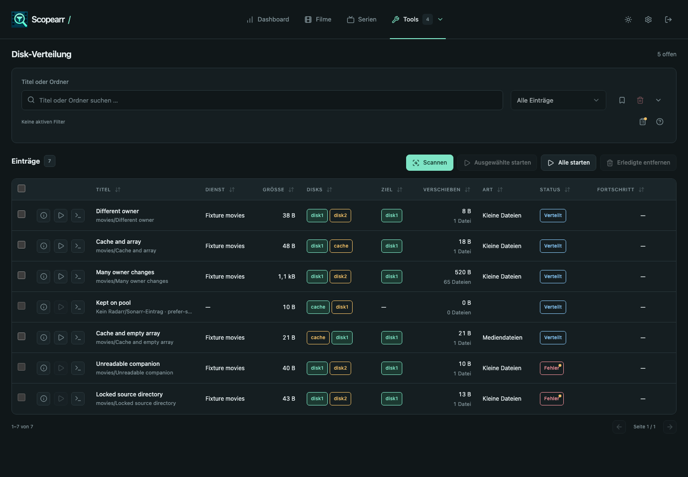
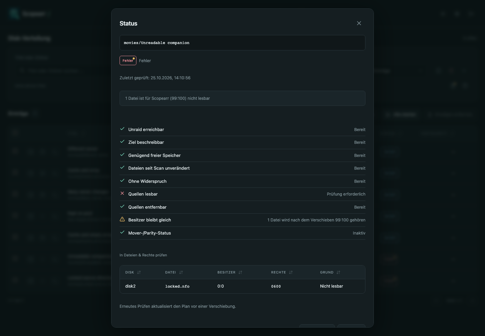
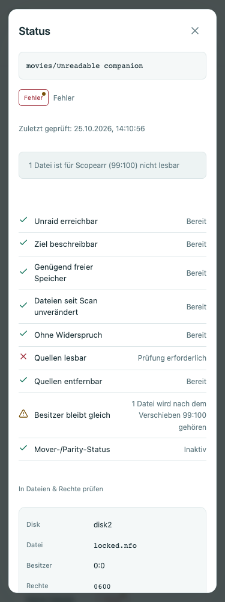
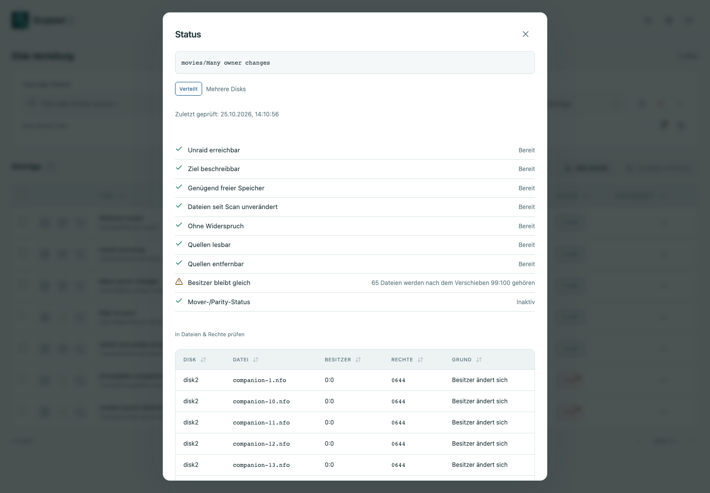
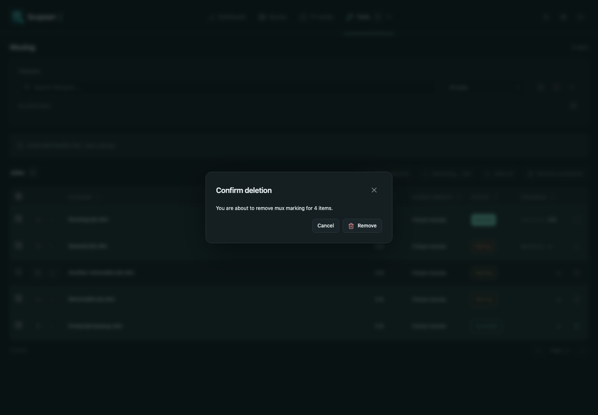
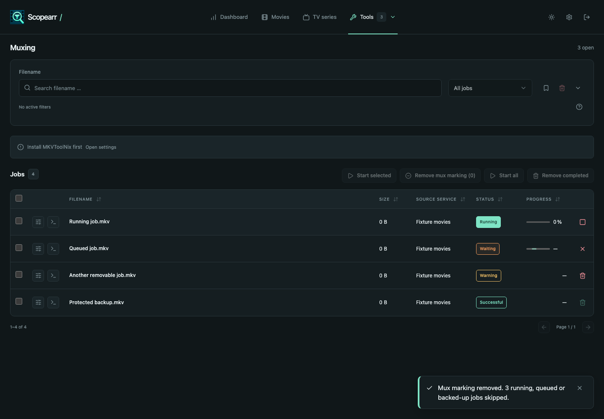

# Scopearr 1.4.6 validation

All media, services and screenshots below are synthetic. No personal media, credentials or appdata were used. Go ran only in `golang:1.27.3` containers.

## Automated checks

- The final full Go race suite passed after all code-review fixes (**316.017 s**), followed by Vet, Staticcheck v0.8.2 and govulncheck v1.8.0. No called/imported vulnerability was found; one advisory affects an unused required-module path. GitHub CI repeats the complete race suite on the final commit.
- Frontend frozen-lockfile install, TypeScript check, **141 tests**, production build and moderate-or-higher dependency audit passed. No dependencies changed. The existing Vite advisory about chunks above 500 kB remains.
- Version checker and all **7 release-CI guard tests** passed.
- The review image starts read-only as **99:100**, with memory and memory-plus-swap both **512 MiB**, answers `/healthz` with version 1.4.6, records `Scopearr 1.4.6 started` and reports no OOM. The Approved release workflow additionally gates both architectures, runtime vulnerability scans and the full 100,000-file media-server container check.

## Placement matrix

`release_146_test.go` covers pool+array content, pool+empty-array copy, one pool, two pools with a new array target, three-device content, Prefer/Only restrictions, missing policy metadata, pool execution and empty-source cleanup. Cache sources join planned influx and bulk eligibility. Existing mover/parity queue tests continue to pass. Share parsing accepts the actual Unraid runtime keys (`useCache`, `cachePool`, `cachePool2`) and prefixed configuration/form aliases. Runtime-format Prefer/Only guards are tested through nested-folder planning and a policy changed after scan before preflight. Parsing is bounded and nested shares inherit their first path component's policy; unknown values follow the ordinary-device model. Report tests exercise live known/unknown policy information.

Access tests inject only the effective-access boundary, retaining the real scanner/planner/checker. Different owners are warnings; unreadable or unremovable sources are errors with concrete reasons. No access call targets the chosen target disk. The same new-case suite also passed as **actual UID 99:GID 100**, including real `faccessat` failures for a mode-0000 file and a non-writable source parent. Browser fixtures additionally use root-owned 0644/0600 files, 99:100 writable parents and root-owned 0755 parents. Source/copy size, mode and timestamp safeguards and expected copy identity remain in the existing execution tests. Owner-changing restart recovery is covered explicitly.

Stored-check tests exercise recheck through HTTP, list projection, save/reload, durable failed preflight, UTC time, unchanged-rescan preservation, changed-file invalidation and new-special-entry invalidation. Failed discovery and inspection attempts replace an older green check, retain the file plan and return the new diagnostic immediately to the open dialog. Unreachable-source properties that could not be checked remain warnings marked Not checked. Targetless special-file entries still receive concrete diagnostics. Each disk/path appears once with its highest-priority blocker; access and owner aggregates remain independent. Large-path fixtures prove **at most 50 distinct files and 16 KiB**, with the omitted distinct-file count preserved at both limits. Checks belong to their row, so row removal removes their diagnostics as well.

## Migration and rollback

A literal 1.4.5 table is reopened and migrated to `check_result TEXT NOT NULL DEFAULT ''`. `PRAGMA user_version` is unchanged. A literal **26-column 1.4.5 SELECT and INSERT** still work, including the empty default for old writers; reopening is idempotent. There is no dependency or incompatible setting change. Rollback to 1.4.5 is unrestricted; run a new scan after updating or rolling back.

## Performance and memory

| Check | Result |
| --- | --- |
| 50,000 cached-file queries | p50 41.51 ms; p95 75.31 ms (budget 200 ms) |
| 50,000 compact placement rows, scan and search | 3.26 s; no retained file lists |
| 100,000 live placement counts | 11.24 ms |
| 100,000 live per-share report | 11.29 ms |
| 20,000-folder metadata scan | 1.82 s; 50.71 MiB peak heap (budget 64 MiB) |
| Instrumented metadata repeat | 53.14 MiB; **2,000 access calls** |

The 2,000 calls are read plus parent write/search for one outside-target file in each of 1,000 multi-device candidates. The 19,000 compact one-device rows cause **no access calls**. Parent sticky-bit metadata is reused from the scan; no file contents are opened during scanning. The injected access function in the synthetic filesystem performance fixture represents paths that do not exist on the host; actual effective access is independently tested above.

## Browser and action validation

**48 combinations** passed: Chromium and WebKit × English/German/Spanish/Italian × 1440/820/375 px × light/dark, with **zero page errors**. They exercise saved timestamps, reason details, warning dots, a full page reload, 50 displayed rows plus 15 omitted rows, live cache policy and absence of the zero-count Mover report column. The diagnostics table uses the existing wide Modal; its desktop scroll/content widths both measure **728 px**, so the reason column is visible. Mobile uses the existing stacked detail-table recipe and viewport-bound dialog.

Action checks prove the start confirmation includes **66 owner changes**, Files & permissions opens with the exact folder search even without configured mappings and shows its existing setup guidance, and Mux bulk removal deletes **one** selected normal job while preserving **three** running/queued/backed-up jobs. The confirmation names all four selected entries, one toast reports the outcome/skips, selection clears and the list reloads. A single remaining marking is removed without a confirmation; protected-only selection is disabled with an explanatory tooltip. Start selected retains its own startability filter despite the expanded selection. Additional browser regressions prove that search, sorting and page changes remove hidden selections from the action immediately; the paging fixture adds 30 synthetic browser-only rows with a valid 25-row page size and leaves the real fixture jobs unchanged. An offline-fixture recheck proves the open dialog immediately receives the failed result and does not mark unperformed access/ownership checks as separate failures or successes.

## Selected synthetic images

