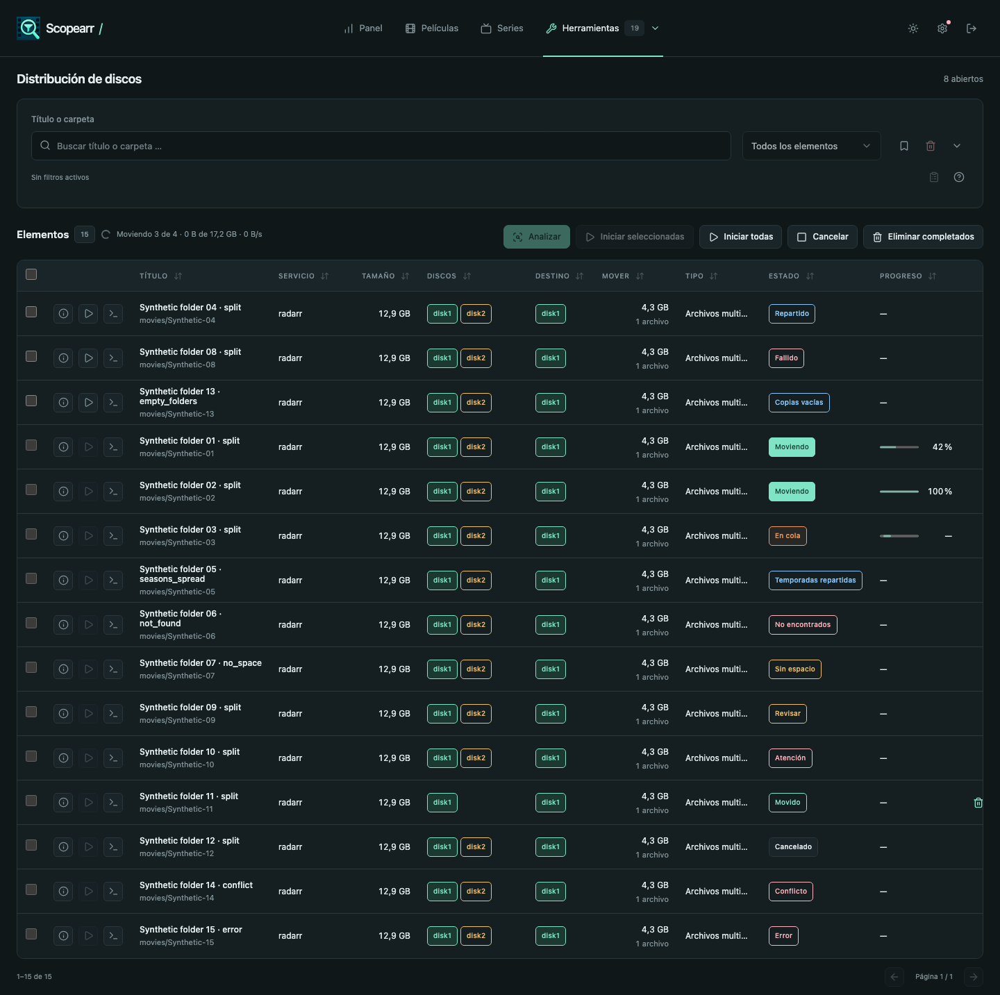
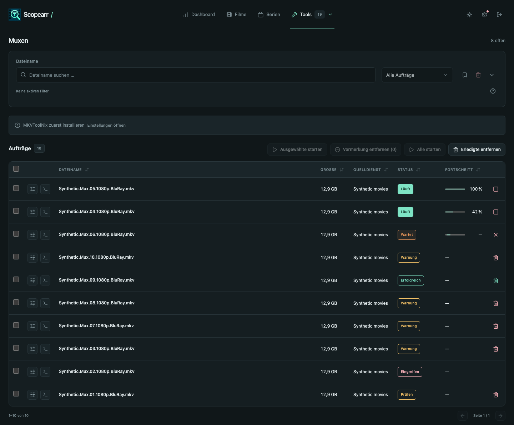
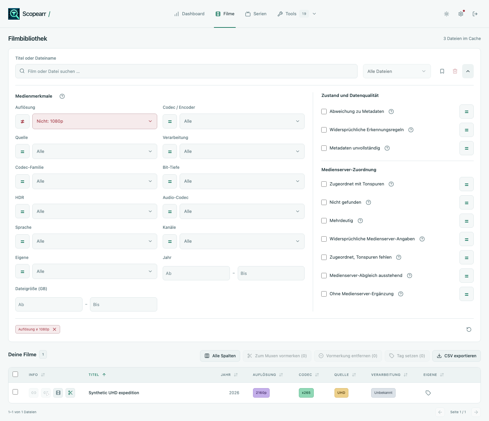
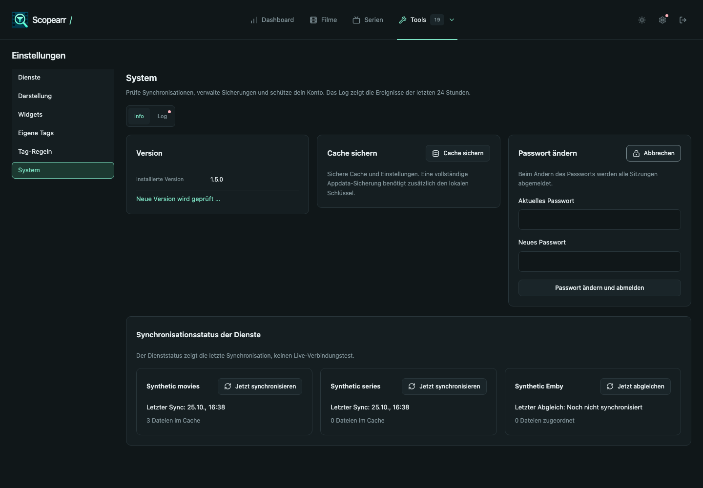
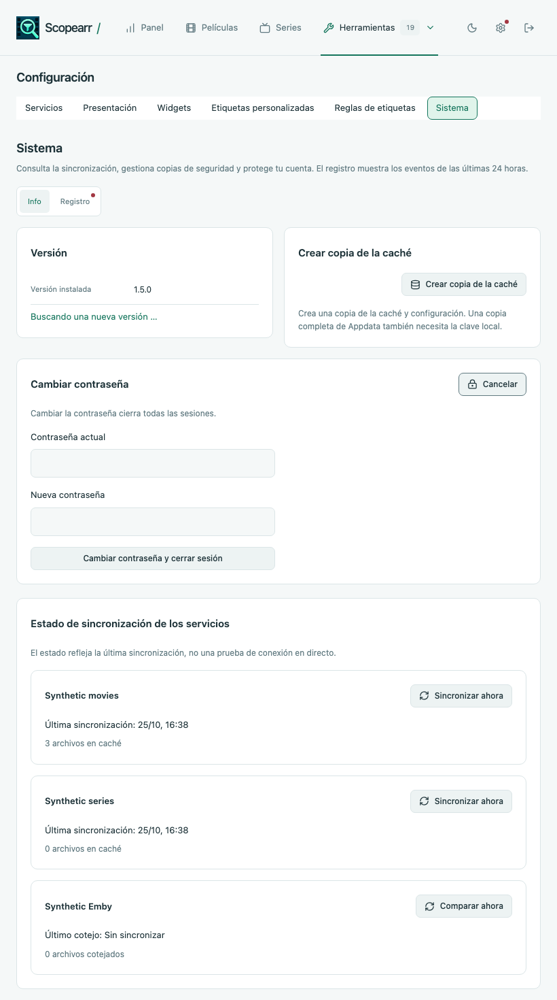
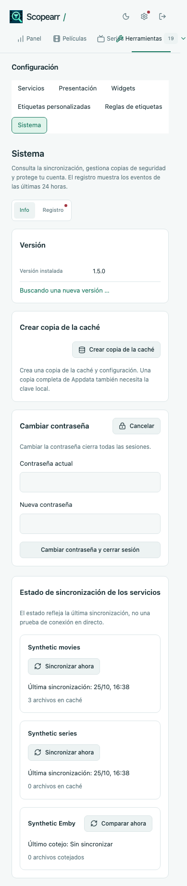
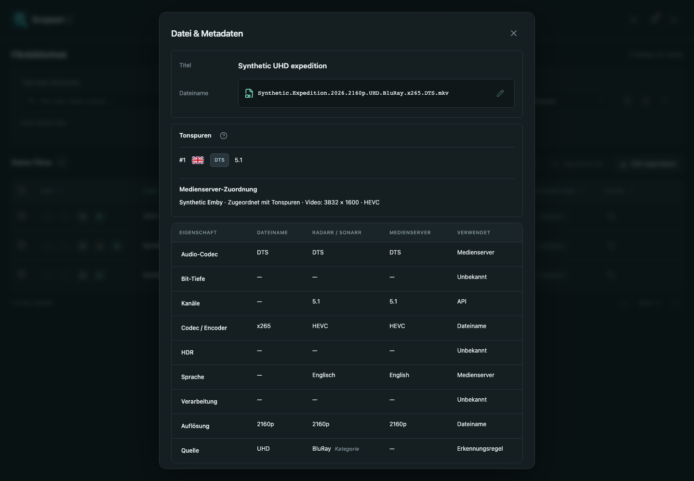

# Scopearr 1.5.0 validation

All services, media and screenshots used for validation are synthetic. Go checks run only in `golang:1.27.3` containers. No private library or Appdata is included.

## Automated checks

The frontend frozen-lockfile install, TypeScript check, **150 tests**, production build and moderate-or-higher dependency audit passed. No dependency changed. Vite retains its existing advisory for chunks larger than 500 kB. The source/package/Docker/release-notes version check and all **7 release-CI guard tests** passed.

The final full Go race suite passed in **335.777 s**, followed by Vet, Staticcheck v0.8.2 and govulncheck v1.8.0. No called or imported vulnerability was found; one advisory affects an unused required-module path. Formatting and whitespace checks passed.

## Media and source regressions

`release_150_test.go` covers cropped video examples, every tier boundary on both axes, missing dimensions, SD and interlaced video, bracketed channel layouts and unknown-layout count fallback. Emby/filename/Arr agreement and two-server agreement include named media instances and old cached video resolutions. Normalization preserves shared immutable metadata snapshots.

Source tests retain the filename value and origin for the four directional category refinements, preserve genuine WEB-DL/BluRay and WEBRip/WEB-DL conflicts, keep custom values strict and leave conflicts between filename rules unchanged. Persisted rules retain 1.4.6's audio-only comparison-pattern validation.

## Cache upgrade and rollback

`release_150_refresh_test.go` exercises stored 1.4.6 media, corrected indexed columns and JSON, active-instance tag reconciliation, backup creation, the one-time marker and a second startup without writes. An SQLite trigger fails after an earlier row has changed, proving full rollback and a successful retry on the next start. Unchanged JSON is not rewritten. Refresh finishes inside `OpenStore`, before sync, webhook or background managers start.

Fresh empty stores set the marker without taking a no-op backup or logging a refresh. A regression test and the historical migration tests verify that this preserves backup counts and leaves retained backup slots available for real changes.

There are no new columns, schema version or recognition rule fields. Saved filters and presets are preserved verbatim; old 6 ch/720p selections can match fewer files after the correction.

The review image was started read-only as **99:100**, with memory and memory-plus-swap both **512 MiB**. `/healthz` returned version **1.5.0**, the log recorded the refresh and `Scopearr 1.5.0 started`, and OOM remained false. A synthetic 1.4.6 cache became 1080p / 5.1 / no source conflict, retained schema version **18**, stored the completion marker and had a database backup. The actual published **1.4.6 image** then started against that refreshed Appdata; its authenticated files API returned the same corrected values, proving old rule compilation and cache reading without a restore.

## Performance and memory

All measurements below ran in a Go container with **GOMAXPROCS=2**, **512 MiB RAM** and **512 MiB memory-plus-swap**, leaving no additional swap allowance.

| Check | Result |
| --- | --- |
| Refresh 50,000 files with stored media metadata | **13.64 s**, **12.24 MiB** sampled peak heap; budget ≤60 s and <512 MiB |
| 50,000 cached-file queries | p50 **45.21 ms**, p95 **81.23 ms**; budget p95 ≤200 ms |
| Statistics over 100,000 cached files | **810.19 ms** |
| 50,000 custom-tag filter | p95 **96.70 ms** |
| 50,000 compact placement rows, scan and search | **3.44 s**, no retained file lists |
| 20,000-folder metadata scan | **1.87 s**, **50.78 MiB** peak heap; budget ≤64 MiB |
| 50,000 episode season-outlier filters | p95 **35.89 ms** (matches), **26.53 ms** (season) |

All selected performance tests passed. The metadata fixture retained the expected **2,000 access calls**, with no media-content reads.

## Interface checks

Frontend tests use a measured Canvas stub for column widths and check all three tool tables, short/full mux labels, progress geometry, the single-owner exclusion recipe, audio layouts, Category evidence and external password form association. Header and tag measurements depend on both the current language and `document.fonts.ready`.

The exclusion recipe has a computed text/background contrast of **5.656:1 in light** and **8.197:1 in dark** in the default palette. Actual browser measurements across **all 18 palettes in both modes** have a minimum of **4.904:1**, exceeding 4.5:1. The initial Nordic dark value failed at 3.753:1; a regression test now guards every shipped palette, and the shared dark status-error token was adjusted before repeating the browser measurement.

Chromium **151.0.7922.34**, WebKit **26.5** and Firefox **153.0** passed **36 tool geometry checks** (all four languages × three tools × three engines), **108 responsive tool visits** and **36 System layouts** (German/Spanish × light/dark × 1440/820/375 px × three engines). Status tags fit their cells without ellipsis. Progress stays **128px**, bars and idle markers start at the left edge, and percentage right edges agree within each table. In Chromium/WebKit, measured placement status widths are **124/129/160/144px** for English/German/Spanish/Italian; Mux uses **120/133/120/125px**, Files & permissions **120/123/120/120px**.

The native macOS Firefox test runtime could not start its graphics helper; the same Firefox matrix passed in the official Playwright 1.62.1 Linux container against the identical local fixture, with no page errors. Chromium and WebKit ran on macOS.

The three System cards form 3 columns, 2 plus 1, and 1 column at the requested widths. Expanding the password card leaves the other cards' heights unchanged. All three engines verified external form ownership, required fields, the 12-character minimum, Enter submitting only `PUT /api/password`, no settings write, rejected old password, accepted new password and terminated sessions. Typing password fields then navigating to Dashboard produces no unsaved-settings confirmation. Native autocomplete attributes remain present; third-party password-manager extensions were not part of this test.

Real cached media in the fixture shows 1912 × 796 as 1080p and 3832 × 1600 as 2160p, with 5.1 channels and no false source disagreement. A WEB-DL/BluRay disagreement remains visible. The file dialog's Category hint has the standard **8px** label gap, and the track shows **5.1** with **5.1(side)** retained in its tooltip.

The existing Spanish 375px header can make the document 389px wide; this comes from the unchanged navigation, while all System cards fit their 327px content width. This release does not alter that header.

## Selected synthetic images

